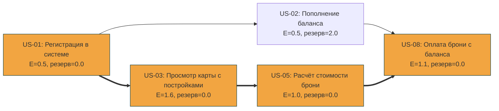

# Сетевой график, PERT и прогноз методом Монте-Карло

---

## 1. Сетевой график (CPM)

### 1.1. Исходные данные

В MVP **запланированы** 5 историй (из Задания 1.4). Оценки длительности — в **неделях** (оптимистичная O, наиболее вероятная M, пессимистичная P). Оценки даны с учётом рисков: US-03 (карта + форма брони) — самая рискованная, US-01/US-02 — стандартные модули Fortify и транзакций.

| ID | История | O | M | P | Зависит от | Обоснование оценок |
|---|---|---|---|---|---|---|
| US-01 | Регистрация в системе | 0.3 | 0.5 | 1.0 | — | Fortify из коробки; риск — настройка Spatie-ролей |
| US-02 | Пополнение баланса | 0.3 | 0.5 | 1.0 | US-01 | Простая форма + запись в `transactions` |
| US-03 | Просмотр карты, выбор постройки и оформление брони | 1.0 | 1.5 | 2.5 | US-01 | Карта, координаты, кастомные иконки + **форма брони с валидацией** — самая рискованная |
| US-05 | Расчёт стоимости брони | 0.5 | 1.0 | 1.5 | US-03 | Формула + UI + тесты |
| US-08 | Оплата брони с баланса | 0.7 | 1.0 | 1.8 | US-02; US-05 | Транзакции, атомарность, проверка баланса |

**Файл** (`examples/mvp-tasks.csv`):

```csv
id,name,o,m,p,depends_on
US-01,Регистрация в системе,0.3,0.5,1.0,
US-02,Пополнение баланса,0.3,0.5,1.0,US-01
US-03,Просмотр карты с постройками,1.0,1.5,2.5,US-01
US-05,Расчёт стоимости брони,0.5,1.0,1.5,US-03
US-08,Оплата брони с баланса,0.7,1.0,1.8,US-02;US-05
```

**Команда:**

```bash
python3 scripts/pert_cpm.py examples/mvp-tasks.csv --deadline 4.5 --mermaid
```

### 1.2. PERT-оценки

`E = (o + 4m + p) / 6`, `σ = (p − o) / 6`.

| ID | История | O | M | P | **E** | **σ** |
|---|---|---|---|---|---|---|
| US-01 | Регистрация | 0.3 | 0.5 | 1.0 | **0.55** | 0.12 |
| US-02 | Пополнение баланса | 0.3 | 0.5 | 1.0 | **0.55** | 0.12 |
| US-03 | Карта + форма брони | 1.0 | 1.5 | 2.5 | **1.58** | 0.25 |
| US-05 | Расчёт стоимости | 0.5 | 1.0 | 1.5 | **1.00** | 0.17 |
| US-08 | Оплата с баланса | 0.7 | 1.0 | 1.8 | **1.08** | 0.18 |

### 1.3. Прямой и обратный проход

| ID | ES | EF | LS | LF | **Резерв** | Критическая? |
|---|---|---|---|---|---|---|
| US-01 | 0.00 | 0.55 | 0.00 | 0.55 | **0.00** | ✅ да |
| US-02 | 0.55 | 1.10 | 2.58 | 3.13 | **2.03** | ❌ нет |
| US-03 | 0.55 | 2.13 | 0.55 | 2.13 | **0.00** | ✅ да |
| US-05 | 2.13 | 3.13 | 2.13 | 3.13 | **0.00** | ✅ да |
| US-08 | 3.13 | 4.22 | 3.13 | 4.22 | **0.00** | ✅ да |

**Ожидаемая длительность проекта = 4.22 нед (PERT-оценка, не факт).**

### 1.4. Критический путь

```
US-01 → US-03 → US-05 → US-08
```

**Длительность:** 0.55 + 1.58 + 1.00 + 1.08 = **4.22 нед**
**σ критического пути:** √(0.12² + 0.25² + 0.17² + 0.18²) ≈ **0.37 нед**

**US-02** (Пополнение баланса) — единственная **некритическая** история с резервом **2.03 нед**. Её можно вести параллельно с US-03/US-05 и не сорвать релиз. Но: US-08 (оплата) зависит от US-02, поэтому если US-02 затянется дольше, чем на 2.03 нед сверх ожидания, она **сама станет критической**.

**Практический вывод:** US-03 (карта + форма брони) — самая длинная и рискованная история. Если она затянется (P = 2.5 нед вместо M = 1.5), весь проект сдвинется на +0.92 нед, потому что US-03 на критическом пути.

### 1.5. Рисунок сетевого графика

Сгенерирован скриптом (`--mermaid`). Жирные стрелки (`==>`) — рёбра критического пути, оранжевые узлы — задачи на критическом пути.



**Легенда:**

| Элемент | Значение |
|---|---|
| Оранжевый узел | Задача на критическом пути (резерв = 0) |
| Жирная стрелка `==>` | Ребро критического пути |
| Обычная стрелка `-->` | Ребро с резервом |
| `E` | PERT-ожидание длительности, нед |
| `резерв` | Slack = LS − ES, нед |

### 1.6. Вывод `pert_cpm.py` на текущих данных

```text
id        E     σ     ES     EF     LS     LF  резерв  задача
US-01  0.55  0.12   0.00   0.55   0.00   0.55    0.00  Регистрация в системе *
US-02  0.55  0.12   0.55   1.10   2.58   3.13    2.03  Пополнение баланса
US-03  1.58  0.25   0.55   2.13   0.55   2.13    0.00  Просмотр карты с постройками *
US-05  1.00  0.17   2.13   3.13   2.13   3.13    0.00  Расчёт стоимости брони *
US-08  1.08  0.18   3.13   4.22   3.13   4.22    0.00  Оплата брони с баланса *

Критический путь: US-01 -> US-03 -> US-05 -> US-08
Ожидаемая длительность проекта: 4.22, σ = 0.37
  срок с вероятностью 50%: 4.22
  срок с вероятностью 85%: 4.60
  срок с вероятностью 90%: 4.69
  срок с вероятностью 95%: 4.83
Вероятность завершить к сроку 4.5: 77.8%
(* — задача на критическом пути; оценка вероятности учитывает только критический путь)
```

---

## 2. PERT-прогноз: вероятность завершения к дате защиты ЛР 3

### 2.1. Расчёт

Ожидаемая длительность критического пути: **`TE = 4.22 нед`**, стандартное отклонение **`σ = 0.37 нед`**.

Для срока `T_target`:

```
Z = (T_target − TE) / σ
P(T ≤ T_target) = Φ(Z)
```

### 2.2. Таблица вероятностей по срокам

| Срок (нед) | Z | P(T ≤ срок) |
|---|---|---|
| 3.5 | −1.95 | 2.6 % |
| 4.0 | −0.59 | 27.6 % |
| **4.22** | **0.00** | **50.0 %** |
| **4.5** | **0.76** | **77.8 %** |
| 4.60 | 1.04 | 85.0 % |
| 4.69 | 1.28 | 90.0 % |
| 4.83 | 1.65 | 95.0 % |
| 5.0 | 2.12 | 98.3 % |

### 2.3. Вывод

- **При сроке 4.5 нед** (условная «дата защиты ЛР 3» через 4.5 недели от старта MVP) вероятность успеть — **77.8 %**. Это ниже типичного порога 85 %, значит **риск опоздания ~22 %** — существенный.
- **Чтобы гарантировать ≥ 85 %**, нужно **≥ 4.6 нед**.
- **Чтобы гарантировать ≥ 95 %**, нужно **≥ 4.83 нед**.

**Рекомендация:** если дата защиты ЛР 3 — **фиксированная и меньше 4.6 нед от старта**, нужно либо:
- урезать объём MVP (убрать US-03 — но тогда ломается сценарий расчёта, зависимость US-05 → US-03);
- либо заложить **буфер 0.4–0.6 нед** на критическом пути (в первую очередь — на US-03, карту и форму брони).

---

## 3. Монте-Карло по пропускной способности

### 3.1. Модель

- **Пропускная способность:** 1–4 истории в неделю (по заданию; своих данных пока нет).
- **История throughput** (10 недель): `[2, 3, 1, 4, 2, 3, 4, 2, 1, 3]`, среднее **2.50 истории/нед**.
- **Бэклог MVP:** **5 историй**.
- **Симуляций:** 10 000, seed = 42.

### 3.2. Данные (`examples/throughput_weekly.csv`)

```csv
week,throughput
1,2
2,3
3,1
4,4
5,2
6,3
7,4
8,2
9,1
10,3
```

### 3.3. Команда запуска

```bash
python3 scripts/monte_carlo.py --csv examples/throughput_weekly.csv --backlog 5 --runs 10000
```

### 3.4. Вывод `monte_carlo.py` на текущих данных

```text
История (10 периодов): [2, 3, 1, 4, 2, 3, 4, 2, 1, 3]; среднее 2.50
Бэклог: 5 задач, симуляций: 10000

 Периодов    Доля  Накоп.
        2   62.6%   62.6%  ##############################################################
        3   33.2%   95.8%  #################################
        4    4.1%   99.8%  ####
        5    0.2%  100.0%  

С вероятностью 50% бэклог будет выполнен не позже чем за 2 нед.
С вероятностью 70% бэклог будет выполнен не позже чем за 3 нед.
С вероятностью 85% бэклог будет выполнен не позже чем за 3 нед.
С вероятностью 95% бэклог будет выполнен не позже чем за 3 нед.
```

### 3.5. Прогноз с вероятностью 50 % и 85 %

| Уровень | Срок | Комментарий |
|---|---|---|
| **P50** | **2 нед** | Медиана: 62.6 % симуляций закрывают бэклог за 2 недели |
| P70 | 3 нед | 95.8 % накопленной доли приходится на ≤ 3 нед |
| **P85** | **3 нед** | Так как 95.8 % ≥ 85 %, перцентиль округляется до 3 нед |
| P95 | 3 нед | 95.8 % ≥ 95 %, поэтому тоже 3 нед |

### 3.6. Расхождение с PERT — почему

| Модель | Результат | Что учитывает |
|---|---|---|
| **PERT (CPM)** | **4.22 нед** (P85 = 4.60) | Длительности **каждой** истории (карта = 1.58 нед), **зависимости**, критический путь |
| **Монте-Карло** | **2 нед** (P50), **3 нед** (P85) | Только **число историй** за неделю, **без учёта размера** и зависимостей |

**Причина расхождения:** в модели Монте-Карло все 5 историй считаются «равными единицами» — 2 истории в неделю × 2 недели = 4 истории, ещё 1 за третью. Но **US-03 (карта + форма брони) — это 1.58 нед работы**, а не «одна история за полнедели». Монте-Карло этого не видит.

**Вывод:** Монте-Карло по «числу историй/нед» даёт **оптимистичную нижнюю оценку**. Для реалистичного прогноза:

- **Пессимистичный сценарий:** PERT (4.22 нед, P85 = 4.60).
- **Оптимистичный сценарий:** Монте-Карло (P50 = 2, P85 = 3 нед).
- **Реалистичная вилка:** **3–4.6 нед** с учётом размера историй.

В **ЛР 4** прогноз будет пересчитан на реальных данных `flow_metrics.py` (throughput в SP/нед) — тогда Монте-Карло станет основным инструментом, а PERT — вспомогательным.

---

## 4. Выводы

1. **Критический путь MVP:** `US-01 → US-03 → US-05 → US-08`, ожидаемая длительность **4.22 нед**, σ = 0.37 нед. US-02 имеет резерв 2.03 нед — можно вести параллельно.

2. **PERT-вероятность к 4.5 нед:** **77.8 %**. Для ≥ 85 % нужно **≥ 4.6 нед**, для ≥ 95 % — **≥ 4.83 нед**. Риск опоздания к 4.5 нед ~22 % — существенный.

3. **Монте-Карло (1–4 истории/нед, 5 историй):** **P50 = 2 нед**, **P85 = 3 нед**. Это оптимистично относительно PERT, потому что модель не учитывает размер историй (карта = 1.58 нед для одной истории).

4. **Расхождение PERT vs Монте-Карло** — методологическое, не ошибка. PERT считает по длительностям и зависимостям, Монте-Карло — по числу историй. Для реалистичного прогноза нужна **вилка 3–4.6 нед**, для пессимистичного — PERT (4.22–4.83 нед).

5. **Рекомендация для защиты ЛР 3:** планировать **≥ 4.6 нед** от старта MVP (P85 PERT). Если срок фиксирован на 4.5 нед — заложить буфер 0.4–0.6 нед на US-03 (карту и форму брони, главный риск) или упростить US-03 (список вместо карты — но это меняет состав MVP).

6. **В ЛР 4** прогноз будет пересчитан на реальных данных `flow_metrics.py` / `throughput_weekly.csv` (throughput в SP/нед) — тогда Монте-Карло станет основным инструментом прогноза, а PERT — вспомогательным.
